```mermaid
xychart-beta
    title "So sanh Throughput (TPS): Baseline Cassandra vs. HMA Phase 6 vs. Aerospike CE 8.1"
    x-axis ["read100-c64", "b1-cas-off-c16", "b1-cas-off-c64", "b1-cas-on-c8", "b1-cas-on-c16"]
    y-axis "Throughput (ops/sec)" 0 --> 90000
    bar [19405, 13395, 14063, 5299, 5902]
    bar [60073, 25863, 32122, 14410, 19715]
    bar [85541, 29984, 34537, 18505, 28118]
```

# Báo cáo Benchmark Toàn diện: Apache Cassandra 7.0 Baseline vs. Aerospike-Inspired HMA Storage Engine (Hoàn chỉnh Phần 1 – Phần 6) & Đối chiếu Aerospike CE 8.1.1.1

Báo cáo tổng hợp kết quả thực nghiệm trên lab **`duongbk`** (`192.168.1.9` / `192.168.68.104`) sử dụng bộ công cụ [`kvbench`](file:///Users/duongnguyen/Projects/cassandra/kvbench) để đánh giá hiệu năng của bản fork [Apache Cassandra 7.0-SNAPSHOT](file:///Users/duongnguyen/Projects/cassandra/cassandra) (`duongbkak55/cassandra`) sau khi hoàn thành toàn bộ **6 giai đoạn tối ưu hóa học hỏi từ Aerospike**:

1. **Phần 1 — 64-Byte Off-Heap Primary Index + Multi-SSTable Direct Offset Jump (Up to 3 SSTables) + Thread-Local Lookup Hint**:
   - [`HMAPrimaryIndex`](file:///Users/duongnguyen/Projects/cassandra/cassandra/src/java/org/apache/cassandra/io/sstable/format/hma/HMAPrimaryIndex.java), [`HMAPrimaryIndexShard`](file:///Users/duongnguyen/Projects/cassandra/cassandra/src/java/org/apache/cassandra/io/sstable/format/hma/HMAPrimaryIndexShard.java), [`HMARecordPointer`](file:///Users/duongnguyen/Projects/cassandra/cassandra/src/java/org/apache/cassandra/io/sstable/format/hma/HMARecordPointer.java), [`SinglePartitionReadCommand`](file:///Users/duongnguyen/Projects/cassandra/cassandra/src/java/org/apache/cassandra/db/SinglePartitionReadCommand.java), [`BigTableReader`](file:///Users/duongnguyen/Projects/cassandra/cassandra/src/java/org/apache/cassandra/io/sstable/format/big/BigTableReader.java), [`BtiTableReader`](file:///Users/duongnguyen/Projects/cassandra/cassandra/src/java/org/apache/cassandra/io/sstable/format/bti/BtiTableReader.java).
2. **Phần 2 — Block-Level Defragmentation (`inuse_sz` Tracking, Direct-Free 0-I/O & Sparse Defrag Scanner)**:
   - [`HMASSTableBlockState`](file:///Users/duongnguyen/Projects/cassandra/cassandra/src/java/org/apache/cassandra/io/sstable/format/hma/HMASSTableBlockState.java), [`HMABlockDefragTask`](file:///Users/duongnguyen/Projects/cassandra/cassandra/src/java/org/apache/cassandra/db/compaction/HMABlockDefragTask.java), [`HMABlockCompactionStrategy`](file:///Users/duongnguyen/Projects/cassandra/cassandra/src/java/org/apache/cassandra/db/compaction/HMABlockCompactionStrategy.java), [`SizeTieredCompactionStrategy`](file:///Users/duongnguyen/Projects/cassandra/cassandra/src/java/org/apache/cassandra/db/compaction/SizeTieredCompactionStrategy.java), [`LeveledCompactionStrategy`](file:///Users/duongnguyen/Projects/cassandra/cassandra/src/java/org/apache/cassandra/db/compaction/LeveledCompactionStrategy.java).
3. **Phần 3 — Direct I/O (`O_DIRECT`) Kernel Bypass & Async I/O Ring**:
   - [`HMADirectIOEngine`](file:///Users/duongnguyen/Projects/cassandra/cassandra/src/java/org/apache/cassandra/io/sstable/format/hma/HMADirectIOEngine.java), [`DirectChecksummedSequentialWriter`](file:///Users/duongnguyen/Projects/cassandra/cassandra/src/java/org/apache/cassandra/io/util/DirectChecksummedSequentialWriter.java), [`SimpleChunkReader`](file:///Users/duongnguyen/Projects/cassandra/cassandra/src/java/org/apache/cassandra/io/util/SimpleChunkReader.java), [`FileHandle`](file:///Users/duongnguyen/Projects/cassandra/cassandra/io/util/FileHandle.java), [`DataComponent`](file:///Users/duongnguyen/Projects/cassandra/cassandra/io/sstable/format/DataComponent.java).
4. **Phần 4 — Streaming Write Buffer (Single-Write Bypass CommitLog & Memtable)**:
   - [`HMAStreamingWriteBuffer`](file:///Users/duongnguyen/Projects/cassandra/cassandra/src/java/org/apache/cassandra/io/sstable/format/hma/HMAStreamingWriteBuffer.java), [`HMAWriteBufferManager`](file:///Users/duongnguyen/Projects/cassandra/cassandra/src/java/org/apache/cassandra/io/sstable/format/hma/HMAWriteBufferManager.java), [`CassandraKeyspaceWriteHandler`](file:///Users/duongnguyen/Projects/cassandra/cassandra/src/java/org/apache/cassandra/db/CassandraKeyspaceWriteHandler.java).
5. **Phần 5 — Native Off-Heap Arena (`cf_arenax` / FFM Arena Bridge) & Pluggable Off-Heap Arena Memtable**:
   - [`HMAOffHeapArenaPool`](file:///Users/duongnguyen/Projects/cassandra/cassandra/src/java/org/apache/cassandra/io/sstable/format/hma/HMAOffHeapArenaPool.java), [`HMAOffHeapArena`](file:///Users/duongnguyen/Projects/cassandra/cassandra/src/java/org/apache/cassandra/io/sstable/format/hma/HMAOffHeapArena.java), [`HMAOffHeapMemtable`](file:///Users/duongnguyen/Projects/cassandra/cassandra/src/java/org/apache/cassandra/db/memtable/HMAOffHeapMemtable.java), [`HMAOffHeapMemtableFactory`](file:///Users/duongnguyen/Projects/cassandra/cassandra/src/java/org/apache/cassandra/db/memtable/HMAOffHeapMemtableFactory.java), [`NativeDecoratedKey`](file:///Users/duongnguyen/Projects/cassandra/cassandra/src/java/org/apache/cassandra/db/NativeDecoratedKey.java), [`MemtableParams`](file:///Users/duongnguyen/Projects/cassandra/cassandra/src/java/org/apache/cassandra/schema/MemtableParams.java), [`ColumnFamilyStore`](file:///Users/duongnguyen/Projects/cassandra/cassandra/src/java/org/apache/cassandra/db/ColumnFamilyStore.java).
6. **Phần 6 — Partition-Level Fast-CAS Engine (1-Phase In-Memory LWT Bypass, Seqlock Pre-Image Cache & Full-Row Shadowing)**:
   - [`HMAFastCasEngine`](file:///Users/duongnguyen/Projects/cassandra/cassandra/src/java/org/apache/cassandra/io/sstable/format/hma/HMAFastCasEngine.java), [`StorageProxy`](file:///Users/duongnguyen/Projects/cassandra/cassandra/src/java/org/apache/cassandra/service/StorageProxy.java), [`CQL3CasRequest`](file:///Users/duongnguyen/Projects/cassandra/cassandra/src/java/org/apache/cassandra/cql3/statements/CQL3CasRequest.java), [`ModificationStatement`](file:///Users/duongnguyen/Projects/cassandra/cassandra/src/java/org/apache/cassandra/cql3/statements/ModificationStatement.java), [`FilteredPartition`](file:///Users/duongnguyen/Projects/cassandra/cassandra/src/java/org/apache/cassandra/db/partitions/FilteredPartition.java), [`HMAFlushObserver`](file:///Users/duongnguyen/Projects/cassandra/cassandra/src/java/org/apache/cassandra/io/sstable/format/hma/HMAFlushObserver.java).

---

## 1. Quản lý Phiên bản Git & Release

- **GitHub Repository**: [`https://github.com/duongbkak55/cassandra`](https://github.com/duongbkak55/cassandra)
- **Nhánh ổn định Phần 1 – Phần 5**: [`hma-main`](https://github.com/duongbkak55/cassandra/tree/hma-main)
- **GitHub Release (`v7.0.0-hma.1`)**: [`https://github.com/duongbkak55/cassandra/releases/tag/v7.0.0-hma.1`](https://github.com/duongbkak55/cassandra/releases/tag/v7.0.0-hma.1)
- **Nhánh phát triển Phần 6 (Fast-CAS + Multi-SSTable Skip + Off-Heap Arena Fixes)**: [`feature/hma-phase6-fast-cas`](https://github.com/duongbkak55/cassandra/tree/feature/hma-phase6-fast-cas)

---

## 2. Cấu hình Hạ tầng & Môi trường Thực nghiệm

- **Host Lab**: `duongbk` (`192.168.1.9`), CPU Intel Core i5-9500 (6 cores @ 3.00GHz), 15 GiB RAM, ổ cứng NVMe `nvme0n1` (`259:0`, Samsung 238.5 GiB).
- **Container Server (`kvbench-hma-db`)**:
  - Giới hạn tài nguyên cgroup v2: `--cpus=4 --cpuset-cpus=0-3 --memory=4g --memory-swap=4g`, `MAX_HEAP_SIZE=2G`, `HEAP_NEWSIZE=512M` (tương đương cấu hình container của **Aerospike CE 8.1.1.1**).
  - Dữ liệu nạp trước mỗi lượt chạy: **5 Waves × 25.000 Partition Keys** (`~5 KiB/bản ghi`, tổng **~696 MiB trên đĩa**), tắt Auto-Compaction và tắt toàn bộ Key/Row/Counter Cache (`nodetool setcachecapacity 0 0 0`).
  - Hoàn toàn trong suốt với mọi chuẩn CQL Driver (`INSERT ... IF NOT EXISTS`, `UPDATE ... IF cas_gen = ?`, `SELECT * FROM ...`): **0 dòng code thay đổi ở phía Cassandra Client**.

---

## 3. Bảng Tổng hợp Đối chiếu Toàn diện: Baseline Cassandra vs. HMA Phần 1–5 vs. HMA Phần 6 vs. Aerospike CE 8.1.1.1

Dữ liệu thực nghiệm thu được từ lượt chạy chuẩn hóa toàn trình `hma_compare_20261023_041606` trên `duongbk`:

| Kịch bản & Concurrency | Baseline Cassandra 7.0 | HMA Phần 1–5 (`v7.0.0-hma.1`) | **HMA Phần 6 (`feature/hma-phase6-fast-cas`)** | **Tăng tốc vs. Baseline** | **Aerospike CE 8.1.1.1** *(Baseline đích)* | **Tỉ lệ đạt được so với Aerospike** |
| :--- | :---: | :---: | :---: | :---: | :---: | :---: |
| **`read100` (`c=8`)** | `13,958.2 TPS`<br>*(P99: 1.41 ms)* | `28,022.4 TPS`<br>*(P99: 0.51 ms)* | **`29,486.8 TPS`**<br>*(P50: 0.24 ms, P99: 0.51 ms)* | **2.11x (+111.3%)** | `40,064 TPS` | **73.6%** |
| **`read100` (`c=32`)** | `17,812.0 TPS`<br>*(P99: 8.48 ms)* | `50,836.3 TPS`<br>*(P99: 1.99 ms)* | **`53,651.4 TPS`**<br>*(P50: 0.51 ms, P99: 1.69 ms)* | **3.01x (+201.2%)** | `75,380 TPS` | **71.2%** |
| **`read100` (`c=64`)** | `19,405.2 TPS`<br>*(P99: 14.71 ms)* | `59,041.2 TPS`<br>*(P99: 3.31 ms)* | **`60,073.3 TPS`** *(đỉnh **62,228.7**)*<br>*(P50: 0.91 ms, P99: 3.32 ms)* | **3.10x (+209.6%)** | `85,541 TPS` | **70.2% – 72.7%** |
| **`b1-cas-off` (`c=16`)**<br>*(50% Read / 50% Write)* | `13,394.5 TPS`<br>*(P99: 3.94 ms)* | `24,578.0 TPS`<br>*(P99: 1.65 ms)* | **`25,862.9 TPS`**<br>*(P50: 0.38 ms, P99: 1.52 ms)* | **1.93x (+93.1%)** | `29,984 TPS` | **86.3%** |
| **`b1-cas-off` (`c=64`)**<br>*(50% Read / 50% Write)* | `14,062.6 TPS`<br>*(P99: 18.51 ms)* | `23,413.7 TPS`<br>*(P99: 10.15 ms)* | **`32,121.6 TPS`**<br>*(P50: 1.17 ms, P99: 6.52 ms)* | **2.28x (+128.4%)**<br>*(+37.2% vs. P5)* | `34,537 TPS` | **93.0%** |
| **`b1-cas-on` (`c=8`)**<br>*(50% Read / 50% LWT CAS)* | `5,298.7 TPS`<br>*(P99: 4.88 ms)* | `6,625.2 TPS`<br>*(P99: 3.63 ms)* | **`14,409.5 TPS`**<br>*(P50: 0.33 ms, P99: 1.28 ms)* | **2.72x (+171.9%)**<br>*(+117.5% vs. P5)* | `18,505 TPS` | **77.9%** |
| **`b1-cas-on` (`c=16`)**<br>*(50% Read / 50% LWT CAS)* | `5,902.0 TPS`<br>*(P99: 9.30 ms)* | `7,940.5 TPS`<br>*(P99: 7.56 ms)* | **`19,714.5 TPS`**<br>*(P50: 0.46 ms, P99: 2.31 ms)* | **3.34x (+234.0%)**<br>*(+148.3% vs. P5)* | `28,118 TPS` | **70.1%** |
| **`b1-cas-on` (`c=64`)**<br>*(50% Read / 50% LWT CAS)* | `6,384.8 TPS`<br>*(P99: 43.04 ms)* | `7,853.9 TPS`<br>*(P99: 36.26 ms)* | **`14,336.6 TPS`** *(đỉnh **16,812.4**)*<br>*(P50: 2.66 ms, P99: 19.41 ms)* | **2.25x – 2.63x**<br>*(+82.5% vs. P5)* | `34,043 TPS` | **42.1% – 49.4%** |



---

## 4. Kiến trúc Chi tiết Phần 6: `HMAFastCasEngine` & Tối ưu Đường Đọc/Ghi Đa SSTable

### 4.1. `HMAFastCasEngine` — 1-Phase Partition-Lock CAS (Bỏ qua 4 pha `system.paxos`)
Trong Cassandra nguyên bản, mỗi lệnh `UPDATE ... IF cas_gen = ?` (LWT) phải đi qua 4 pha Paxos (`Prepare/Promise` $\rightarrow$ `Read` $\rightarrow$ `Propose/Accept` $\rightarrow$ `Commit/Ack`), tạo ra **4 lượt ghi `CommitLog` + 4 lượt cập nhật bảng `system.paxos`** trên mỗi giao dịch.

Với [`HMAFastCasEngine.java`](file:///Users/duongnguyen/Projects/cassandra/cassandra/src/java/org/apache/cassandra/io/sstable/format/hma/HMAFastCasEngine.java) được móc trực tiếp vào [`StorageProxy.cas(...)`](file:///Users/duongnguyen/Projects/cassandra/cassandra/src/java/org/apache/cassandra/service/StorageProxy.java):
1. **16.384 Partition Lock Stripes + Monotonic Microsecond Clock**:
   - Dựa trên `key.getToken().getLongValue()`, khóa ngay lập tức stripe của partition (`ReentrantLock`) và cấp phát nhãn thời gian microsecond tăng đơn điệu nghiêm ngặt cho từng stripe (`STRIPE_LAST_MICROS`).
2. **8.192-Slot Seqlock Pre-Image Cache (`STRIPE_WRITE_SEQ` + `STRIPE_CACHE`)**:
   - Trong tải viễn thông (`READ` toàn bộ thuê bao $\rightarrow$ tính toán $\rightarrow$ `UPDATE ... IF cas_gen = ?`), lệnh `READ` đi trước tự động lưu `FilteredPartition` vào `STRIPE_CACHE` kèm bộ đếm seqlock `STRIPE_WRITE_SEQ` (được bảo vệ bởi `beginPartitionWrite` / `endPartitionWrite` trong [`ColumnFamilyStore.apply()`](file:///Users/duongnguyen/Projects/cassandra/cassandra/src/java/org/apache/cassandra/db/ColumnFamilyStore.java)).
   - Khi `executeCas` chạy ngay sau đó trên cùng `DecoratedKey` mà không có lệnh ghi xen kẽ (`seqAfter == cached.writeSeq`), `HMAFastCasEngine` **tái sử dụng ngay lập tức bản ghi `FilteredPartition` trong bộ nhớ (0 Disk I/O, 0 Memtable Lookup)** để kiểm tra `request.appliesTo(current)`!
3. **Full-Row Merge + Partition Shadow Tombstone (`commitMicros - 1`)**:
   - Thay vì chỉ ghi 4/10 cột delta vào Memtable (khiến các lệnh `READ` tiếp theo vẫn phải đọc thêm SSTable dưới đĩa để lấy 6 cột còn lại), `HMAFastCasEngine` hợp nhất luôn dòng đầy đủ (`Rows.merge(currentRow, deltaRow)`) và gắn `DeletionTime(commitMicros - 1)` ở cấp độ partition.
   - Kết quả:
     - Mọi truy vấn `SELECT *` tiếp theo thấy `sstable.getMaxTimestamp() < mostRecentPartitionTombstone` nên **phục vụ 100% từ `HMAOffHeapMemtable` mà không cần chạm vào bất kỳ SSTable hay `HMAPrimaryIndex` nào**.
     - Khi Memtable flush xuống đĩa, [`HMAFlushObserver`](file:///Users/duongnguyen/Projects/cassandra/cassandra/src/java/org/apache/cassandra/io/sstable/format/hma/HMAFlushObserver.java) ghi nhận đủ 10/10 cột (bao gồm cột phức hợp `Map` `wallet_balances`) và đánh dấu `FLAG_COMPLETE_OVERWRITE` (1-SSTable Jump).

### 4.2. Chuỗi 3-SSTable Direct Jump & Cắt ngắn SSTable trong `SinglePartitionReadCommand`
- Mở rộng cấu trúc 64-byte [`HMARecordPointer`](file:///Users/duongnguyen/Projects/cassandra/cassandra/src/java/org/apache/cassandra/io/sstable/format/hma/HMARecordPointer.java) (tận dụng các byte dự trữ `49..53` trong cùng 1 CPU cache line 64-byte):
  - `OFFSET_EXT_FLAGS = 49` (`EXT_FLAG_THREE_SSTABLE = 0x01`) và `OFFSET_FIRST_DELTA_SSTABLE_ID = 50` (4-byte `int`).
  - Cho phép theo dõi chính xác chuỗi **3 SSTables (`latestDeltaSstableId` + `firstDeltaSstableId` + `baseSstableId`)** cùng cờ `FLAG_BASE_COMPLETE = 0x10`.
- Cập nhật cả 2 nhánh đọc trong [`SinglePartitionReadCommand.java`](file:///Users/duongnguyen/Projects/cassandra/cassandra/src/java/org/apache/cassandra/db/SinglePartitionReadCommand.java) (`queryMemtableAndDiskInternal` và `queryMemtableAndSSTablesInTimestampOrder`):
  - Bỏ qua hoàn toàn mọi SSTable không nằm trong bộ `(sstableId, firstDeltaSstableId, baseSstableId)` hoặc có `descriptor.id < baseSstableId` khi `FLAG_BASE_COMPLETE` được bật.
  - Kết quả: Thông lượng **`b1-cas-off-c64` (Mixed 50/50 sau nhiều lần flush)** tăng vọt lên **`32,121.6 TPS`** (đạt **93.0%** hiệu năng của Aerospike CE 8.1.1.1!).

### 4.3. Sửa lỗi Quản lý Slab & Định mức Bộ nhớ trong `HMAOffHeapArena` / `HMAOffHeapMemtable`
- Trong [`HMAOffHeapArena.java`](file:///Users/duongnguyen/Projects/cassandra/cassandra/src/java/org/apache/cassandra/io/sstable/format/hma/HMAOffHeapArena.java) và [`HMAOffHeapArenaPool.java`](file:///Users/duongnguyen/Projects/cassandra/cassandra/src/java/org/apache/cassandra/io/sstable/format/hma/HMAOffHeapArenaPool.java):
  - Tăng số lượng stripe cấp phát từ `8` lên **`32` stripes** để giảm tranh chấp CAS ở `c=64`.
  - Sửa lỗi rò rỉ slab khi hai luồng cùng gọi `allocateFromNewSlab` và một luồng thua CAS (`pool.releaseSlab(next)`).
  - Giới hạn `maxPooledSlabs = 64` (64 MiB) và theo dõi chính xác dung lượng cấp phát mỗi thao tác qua `trackingCloner` (`HMAOffHeapCloner.allocatedBytes()`), quy đổi theo hệ số `1/6` vào bộ đếm `operationsWithOffHeap` của Cassandra để `HMAOffHeapMemtable` tự động flush mượt mà ở ngưỡng `~672 MB` off-heap mà không bao giờ gây tràn bộ nhớ container 4 GB.

---

## 5. Thống kê JMX MBean Toàn trình sau Benchmark Phần 6 (`hma_compare_20261023_041606`)

| Nhóm Cơ chế HMA | Chỉ số JMX (`org.apache.cassandra.io.sstable:type=HMAPrimaryIndex`) | Giá trị Thực tế | Ý nghĩa Kỹ thuật |
| :--- | :--- | :---: | :--- |
| **Phần 1: Off-Heap Index** | `HitRate` / `LookupHits` / `LookupMisses` | **`1.0` (`6,978,094` hits / `0` misses)** | 100% tra cứu khóa tìm thấy chính xác trong bảng băm Off-Heap 64-byte. |
| **Phần 1: Direct Offset Jump** | `DirectReadBypassCount` | **`7,273,759` lượt** | Hơn 7,27 triệu lượt đọc nhảy thẳng tới offset dữ liệu SSTable mà không qua Bloom Filter / Partition Index. |
| **Phần 2: Block Defrag** | `TotalDirectFreedSSTables` / `TotalDefraggedSSTables` | **`4` freed / `14` defragged** | Thu hồi **`557,094,970 B` (~531.3 MiB)** dữ liệu rác, nâng tỉ lệ dữ liệu sống `GlobalLiveUtilizationPct` lên **`86.872%`**. |
| **Phần 3: Direct I/O (`O_DIRECT`)** | `DirectIOReads` / `DirectIOBytesRead` | **`424,578` reads / `3.42 GiB`** | Đọc trực tiếp từ ổ NVMe vật lý với `O_DIRECT`, bỏ qua hoàn toàn OS Page Cache. |
| **Phần 4: Streaming Write Buffer** | `CommitLogBypassedCount` / `StreamingBufferFlushes` | **`112,416` writes / `20` flushes** | Ghi 1 lần (Single-Write) `159.9 MiB` thẳng xuống SSTable với độ trễ ghi nội bộ **`18 µs` (`0.018 ms`)**. |
| **Phần 5: Off-Heap Arena & Memtable** | `OffHeapArenaCreatedCount` / `ClosedCount` / `ActiveBytes` | **`29` created / `28` closed / `0 B` active** | Cấp phát tổng cộng **`2.99 GiB`** (`OffHeapArenaTotalBytesAllocated = 3,210,739,712 B`), thu hồi sạch 100% slab sau khi flush. |
| **Phần 6: Fast-CAS Engine** | `FastCasEnabled` / `FastCasSuccessCount` / `FastCasConditionNotMetCount` | **`true` / `440,280` thành công / `165` conflict** | 440.280 giao dịch LWT CAS hoàn tất trong 1 pha khóa phân vùng + Seqlock Pre-Image Cache, đẩy thông lượng `b1-cas-on-c16` tăng **3.34x** (`19,714.5 TPS`). |

---

## 6. Hướng dẫn Sizing & Cấu hình Tối ưu cho 1 Triệu Bản ghi (`1M Records`, `~5 GiB`) & 10 Triệu Bản ghi (`10M Records`, `~50 GiB`)

### 6.1. Bảng Phân bổ Bộ nhớ (JVM Heap vs. Off-Heap Index vs. Off-Heap Memtable)

| Thành phần Bộ nhớ | Công thức Tính toán | **1M Records (`~5 GiB` dữ liệu)**<br>*(Profile Tiết kiệm 4 GB RAM)* | **1M Records (`~5 GiB` dữ liệu)**<br>*(Profile Khuyến nghị 8 GB RAM)* | **10M Records (`~50 GiB` dữ liệu)**<br>*(Profile Khuyến nghị 16 GB RAM)* |
| :--- | :--- | :---: | :---: | :---: |
| **RAM Container (`--memory`)** | Tổng ngân sách RAM vật lý / cgroup | **`4g`** *(tối thiểu)* | **`8g`** *(khuyến nghị)* | **`16g`** |
| **JVM Max Heap (`MAX_HEAP_SIZE`)** | `35% – 45%` RAM container | **`1792M`** *(1.75 GiB)* | **`3G`** *(3.0 GiB)* | **`6G`** *(6.0 GiB)* |
| **JVM Young Gen (`HEAP_NEWSIZE`)** | `~25% – 30%` `MAX_HEAP_SIZE` | **`512M`** | **`800M`** | **`1536M`** *(1.5 GiB)* |
| **HMA Off-Heap Primary Index** | `64 B × nextPow2(keys / 0.70)` | **`128 MiB`** *(2,097,152 slots)* | **`128 MiB`** *(2,097,152 slots)* | **`1,024 MiB`** *(16,777,216 slots)* |
| **HMA Off-Heap Memtable (`max_offheap_mb`)** | Active + 1 Memtable đang flush | **`192 MiB`** *(đỉnh ×2 = 384 MiB)* | **`256 MiB`** *(đỉnh ×2 = 512 MiB)* | **`512 MiB`** *(đỉnh ×2 = 1 GiB)* |
| **HMA Off-Heap Arena Pool (`max_pooled_slabs`)** | `max_pooled_slabs × 1 MiB` | **`64 MiB`** *(`64` slabs)* | **`128 MiB`** *(`128` slabs)* | **`256 MiB`** *(`256` slabs)* |
| **Direct ByteBuffers / Netty / Native JVM** | NIO + Thread stacks + Bloom Filters | `~350 MiB` | `~512 MiB` | `~1.0 GiB` |
| **OS Page Cache / Direct I/O Headroom** | Phần RAM còn lại cho I/O & Compaction | `~1.2 GiB` | **`~3.7 GiB`** | **`~6.2 GiB`** |

### 6.2. Lệnh Khởi chạy Docker Tối ưu cho 1 Triệu Bản ghi (`1M Records × 5 KiB`)

#### Cấu hình Khuyến nghị (Container `8 GB RAM`, `MAX_HEAP_SIZE=3G`, Pre-allocated 1M Index):
Cấp phát sẵn `64` shards × `32.768` slots (`128 MiB` Off-Heap Index) ngay khi tạo bảng để **không phải resize bảng băm** khi nạp vượt mốc `716.800` keys:

```bash
docker run -d \
  --name cassandra-hma-1m \
  --cpus=4 --memory=8g --memory-swap=8g \
  -p 9042:9042 \
  -e MAX_HEAP_SIZE=3G \
  -e HEAP_NEWSIZE=800M \
  -e JVM_EXTRA_OPTS="\
    -Dcassandra.hma.enabled=true \
    -Dcassandra.hma.index.shards=64 \
    -Dcassandra.hma.index.initial_shard_capacity=32768 \
    -Dcassandra.hma.memtable.auto_enable=true \
    -Dcassandra.hma.memtable.max_offheap_mb=256 \
    -Dcassandra.hma.memtable.offheap_divisor=2 \
    -Dcassandra.hma.arena.max_pooled_slabs=128 \
    -Dcassandra.hma.fast_cas.enabled=true \
    -Dcassandra.hma.defrag.enabled=true" \
  duongbkak55/cassandra-hma:v7.0.0-hma.2
```

#### Cấu hình Giới hạn `4 GB RAM` (`MAX_HEAP_SIZE=1792M`, `max_offheap_mb=192`):
```bash
docker run -d \
  --name cassandra-hma-1m-4g \
  --cpus=4 --memory=4g --memory-swap=4g \
  -p 9042:9042 \
  -e MAX_HEAP_SIZE=1792M \
  -e HEAP_NEWSIZE=512M \
  -e JVM_EXTRA_OPTS="\
    -Dcassandra.hma.enabled=true \
    -Dcassandra.hma.index.shards=64 \
    -Dcassandra.hma.index.initial_shard_capacity=32768 \
    -Dcassandra.hma.memtable.auto_enable=true \
    -Dcassandra.hma.memtable.max_offheap_mb=192 \
    -Dcassandra.hma.memtable.offheap_divisor=2 \
    -Dcassandra.hma.arena.max_pooled_slabs=64 \
    -Dcassandra.hma.fast_cas.enabled=true \
    -Dcassandra.hma.defrag.enabled=true" \
  duongbkak55/cassandra-hma:v7.0.0-hma.2
```

### 6.3. Lưu ý Quan trọng ở Phía Client `kvbench` (`conf/cassandra-b1-5k-1m.yaml`)

1. **Đồng bộ `run.load.records: 1000000` và `keys.count: 1000000`**:
   - Nếu dùng file mẫu 10M (`keys.count: 10000000`) mà chỉ sửa `load.records: 1000000`, pha `run` sẽ sinh khóa ngẫu nhiên trong dải `0 .. 9.999.999` khiến **90% lượt đọc rơi vào khóa chưa từng nạp** $\rightarrow$ báo `not found`. File [`conf/cassandra-b1-5k-1m.yaml`](file:///Users/duongnguyen/Projects/cassandra/kvbench/conf/cassandra-b1-5k-1m.yaml) đã được cấu hình đồng bộ cả hai tham số này ở mức `1000000`.
2. **Đặt `requestTimeoutMs: 5000`, `load.concurrency: 128`, `pool.localConnections: 4` và `retryPolicy: default`**:
   - Nạp 1 triệu bản ghi × 5 KiB (`~5.2 GiB`) kích hoạt liên tiếp ~20 đợt flush Memtable và L0 $\rightarrow$ L1 Compaction. Tăng `requestTimeoutMs` từ `1000` lên `5000` ms và bật `retryPolicy: default` loại bỏ triệt để lỗi timeout nhất thời (`Other error`) khi nạp.
3. **Các bản vá ổn định ở quy mô 1M+ bản ghi (đã tích hợp trong `v7.0.0-hma.2`)**:
   - **Commit nguyên tử `HMAFlushObserver.complete()` & loại bỏ Negative-Skip sớm trong `BigTableReader` / `BtiTableReader`**: Ngăn chặn hoàn toàn hiện tượng `not found` giả khi đọc song song lúc Compaction đang ghi SSTable mới.
   - **Cập nhật `baseSstableId` khi Base SSTable được Compact (`HMAPrimaryIndexShard`) & bỏ `hmaBaseCompleteCutoff` (`SinglePartitionReadCommand`)**: Giữ nguyên chuỗi nhảy 2-SSTable chính xác ngay cả khi Base SSTable cũ được gộp sang SSTable mới có ID lớn hơn Delta SSTable.
   - **Kích hoạt chính xác Full-Row Merge trong `HMAFastCasEngine` & chặn lưu Pre-Read thiếu cột (`SinglePartitionReadCommand`)**: Khắc phục điều kiện `SelectionColumnFilter.fetchesAllColumns(false)` luôn trả về `false` trong `CQL3CasRequest`, đảm bảo `UPDATE ... IF gen = ?` luôn gộp đủ 10/10 cột và không bao giờ làm mất các cột không nằm trong mệnh đề `SET`.
